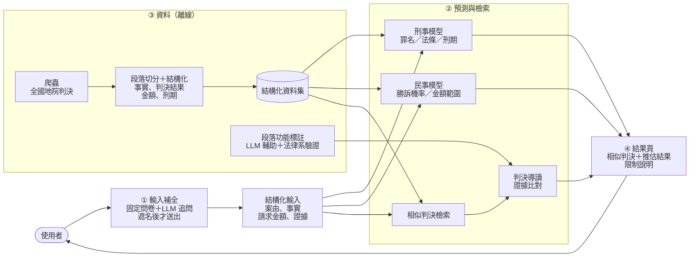

# JudgementDigest：刑事及民事類案判決參考平台

面臨法律糾紛時，民眾往往不清楚自身的法律風險，也不知道下一步該怎麼做。自行上網搜尋或詢問生成式 AI，可能得到不存在的判決或沒有依據的說法。

本系統以**全國地方法院的真實判決**為基礎：使用者描述案情或提供起訴書（狀）事實，系統找出**相似的真實判決**，並推估可能的結果，作為規劃後續法律協助的參考。

> **這不是什麼**：本平台不是 AI 律師，不提供法律意見，也不預測個案一定會怎麼判。所有結果都是「類似案件**如果打到判決**，通常怎麼判」的統計參考，並附上真實判決的字號供查證。和解、撤回、調解成立的案件沒有判決書，不在資料內。

## 功能

| | 輸入 | 輸出 | 第一版（目前） |
|---|---|---|---|
| **民事勝訴機率** | 原告主張＋使用者填得出來的案件特徵 | 勝訴機率 | 🟢 只用原告主張的 TF-IDF＋案件特徵 |
| **民事金額範圍** | 請求金額＋相似的勝訴判決 | 判准金額的 80% 範圍 | 🟢 相似判決的獲償比例 |
| **相似判決檢索**（刑事、民事共用） | 案情描述 | 最相似的真實判決（字號、結果、刑期／判准金額） | 🟢 民事；刑事為示例資料 |
| **證據對照、常見抗辯** | 相似判決＋使用者有的證據 | 相似判決提到哪些證據（提到 ≠ 採信）、被告常見的抗辯 | 🟢 關鍵字規則 |
| **輸入補全** | 案情描述 | 固定問卷＋追問缺漏的事實，送出前遮名預覽 | 🟡 固定題庫；LLM 追問待加入 |
| **判決導讀** | 相似判決 | 標出爭點、證據、法院判斷等段落 | 🟡 規則初步標示；待段落功能標註 |
| **刑事** | 犯罪事實 | 罪名、法條、刑期區間 | ⬜ 示例資料，刑事組開發中 |
| **法官論理傾向分析** | 段落功能標註 | 法官事實認定與論理的傾向（民眾版不呈現） | ⬜ 規劃中 |

🟢 已接上真正的模型或資料　🟡 先用規則版　⬜ 示例資料或尚未開始。示例資料在網頁上都會標示。

## 系統架構



## 資料

- 來源：[司法院裁判書查詢系統](https://judgment.judicial.gov.tw/FJUD/default.aspx)，全國地方法院判決（含簡易庭）
- 規模：（待補：刑事 ___ 件、民事 ___ 件，年份 2022–2025）
- 處理：以規則切分段落，擷取事實、判決結果、金額、刑期、法官等欄位，欄位定義見 [docs/欄位說明.md](docs/欄位說明.md)
- 刑事另從[司法院資料開放平臺](https://opendata.judicial.gov.tw/)取得全國地院刑事判決（`data_pipeline/opendata_*.py`）
- 資料庫、HTML 原檔與模型權重不放在 repo 裡（檔案太大，且含當事人資訊）

## 目前結果

**民事**（文字資料集 v5：46,683 件對審、通常程序的一審判決，5 折交叉驗證）

- 研究用的模型：兩造主張都有時 AUC 0.827（TF-IDF＋Longformer＋結構化）
- **平台第一版**：只用原告主張的 TF-IDF＋案件特徵，AUC 0.771、校準誤差 0.021；問卷特徵沒有提高 AUC，只改善校準；什麼都不填時 AUC 0.764、校準誤差 0.045（`python -m civil.models.service evaluate`）
- 以上都是用法官整理過的原告主張測的。72 件模擬的民眾口語描述（模型沒看過的真實案件，改寫時不知道結果；還不是真人測試）：AUC 0.722，但平均機率 0.46，實際約 0.60，贏和輸的平均差距只有 0.08
- 金額：只能給範圍，約 64% 的預測落在實際金額的 2 倍以內
- 輸入寫得越短越不準（150 字時 AUC 降到 0.692），所以前端要先把事實問完整

**刑事**：（待補）

## Repo 結構

```
JudgementDigest/
├── config.py          資料庫、資料集、模型檔的路徑（可用環境變數改）
├── data_pipeline/     資料蒐集與處理：爬蟲、開放資料、HTML 解析、民事與刑事結構化欄位
├── civil/             民事：dataset/（建資料集的程式）、models/（勝訴機率、金額）、insights.py（證據、抗辯、金額範圍）
├── criminal/          刑事：dataset/（事實取得與遮蔽的程式）、models/（罪名、法條、刑期）
├── retrieval/         相似判決檢索：engine.py（共用）、civil.py、build.py、masking.py（遮名）
├── annotation/        段落功能標註：LLM 輔助標註、驗證（判決導讀、法官論理傾向分析的基礎）
├── backend/           API 伺服器（FastAPI）
├── frontend/          網頁（React＋Vite）
├── scripts/           輔助工具（瀏覽資料庫）
├── docs/              爬蟲用法、欄位說明、資料版本、刑事結構化規則、repo 結構
├── docker-compose.yml
└── tests/
```

資料庫、HTML 原檔、資料集 CSV、模型權重都不放在 repo 裡（太大，且含當事人資訊），repo 只放程式。
資料怎麼產生、放在哪裡見 [docs/資料版本.md](docs/資料版本.md)；各資料夾的內容與負責人見 [docs/repo結構.md](docs/repo結構.md)。

## 快速開始

### 用 Docker 啟動整個平台

```bash
docker compose up --build
```

開 http://localhost:8080 。8080 被占用時改用別的 port：`JD_PORT=8180 docker compose up --build`。

模型與檢索資料（`artifacts/`）不在 repo 裡，由組內另外分享：

| 情況 | 民事顯示 | 適合 |
|---|---|---|
| 只下載 repo | 示例資料（頁面會標示），流程照樣走得完 | 開發前端、後端、跑測試 |
| 把分享的 `artifacts/` 放在 repo 根目錄 | 真實的模型與判決 | 測試真實結果、部署 |

不用改設定，後端啟動時會自己判斷。

### 本機開發

需要 Python 3.9 以上、Node.js 20 以上。所有指令都在 repo 根目錄執行。

```bash
python -m venv .venv
.venv\Scripts\activate          # Windows
# source .venv/bin/activate      # macOS / Linux
pip install -r requirements.txt -r backend/requirements.txt

python -m unittest discover -s tests -t .     # 離線測試

uvicorn backend.main:app --reload             # 後端，API 文件在 http://127.0.0.1:8000/docs
cd frontend && npm install && npm run dev     # 前端（另開一個終端機），http://localhost:5173
```

要用真正的模型，先準備資料（見 [docs/資料版本.md](docs/資料版本.md)），再建立模型檔：

```bash
python -m civil.models.service evaluate       # 5 折評估
python -m civil.models.service train          # → artifacts/civil_winloss_v1/
python -m retrieval.build                     # → artifacts/retrieval_civil_v3/（要有 judgments.db，約 35 分鐘）
```

爬取與資料處理：

```bash
python data_pipeline/crawl_monthly.py --court 臺灣臺北地方法院 --case-type 民事 --judgment-type 判決 --year 2025
python data_pipeline/html_parser.py
python scripts/browse_db.py
```

- 爬取與建立資料庫的完整用法：[docs/crawler.md](docs/crawler.md)
- 資料庫欄位：[docs/欄位說明.md](docs/欄位說明.md)
- 刑事結構化規則：[docs/criminal/structure.md](docs/criminal/structure.md)

## 限制

- 結果只代表「打到判決」的案件；約 26–29% 的通常程序民事案件以和解、撤回、調解結束，沒有判決書
- 模型讀的是法官整理過的事實，口語描述的機率會偏低、分不太出輸贏；訓練時加入短版文字沒有改善（見 `retrieval/README.md`）
- 遮名是規則版，判決裡的第三人姓名仍可能漏掉，正式公開前要再處理
- 法院「為什麼採信」很難自動判斷；證據比對只說「相似判決提到哪些證據」，不代表法院會採信
- 法官事實認定論理傾向分析仍在規劃中；法官層級的結果會附樣本數與限制說明，民眾版只呈現法院與案件類型層級
- 平台不保存使用者輸入的資料

## 授權

[MIT](LICENSE)
