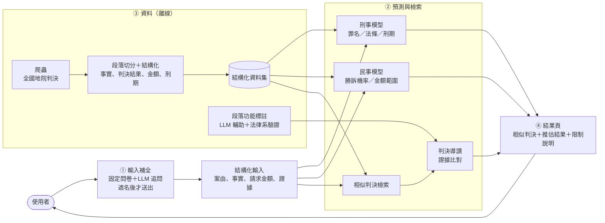

# JudgementDigest：刑事及民事類案判決參考平台

（專題題目：刑事及民事案件判決預測平台）

面臨法律糾紛時，民眾往往不清楚自身的法律風險，也不知道下一步該怎麼做。自行上網搜尋或詢問生成式 AI，可能得到不存在的判決或沒有依據的說法。

本專題以**全國地方法院的真實判決**為基礎：使用者描述案情或提供起訴書（狀）事實，系統找出**相似的真實判決**，並推估可能的結果，作為規劃後續法律協助的參考。

> **這不是什麼**：本平台不是 AI 律師，不提供法律意見，也不預測個案一定會怎麼判。所有結果都是「類似案件**如果打到判決**，通常怎麼判」的統計參考，並附上真實判決的字號供查證。和解、撤回、調解成立的案件沒有判決書，不在資料內。

## 功能

| | 輸入 | 輸出 | 狀態 |
|---|---|---|---|
| **相似判決檢索**（刑事、民事共用） | 案情描述 | 最相似的真實判決（字號、結果、刑期／判准金額） | 🟡 試做中 |
| **刑事** | 犯罪事實 | 罪名、法條、刑期區間 | 🟡 開發中 |
| **民事** | 原告主張＋案件特徵 | 勝訴機率（有校準）、獲償金額範圍 | 🟡 勝敗可用；金額只到範圍 |
| **判決導讀** | 相似判決 | 標出爭點、證據、法院判斷等段落 | ⬜ 依段落功能標註 |
| **證據比對** | 相似判決＋使用者有的證據 | 相似判決提到哪些證據（提到 ≠ 採信） | ⬜ |
| **輸入補全** | 案情描述 | 固定問卷＋LLM 追問缺漏的事實 | ⬜ |
| **法官論理傾向分析** | 段落功能標註 | 法官事實認定與論理的傾向（民眾版不呈現） | ⬜ 規劃中 |

🟢 完成　🟡 進行中　⬜ 尚未開始

## 系統架構



## 資料

- 來源：[司法院裁判書查詢系統](https://judgment.judicial.gov.tw/FJUD/default.aspx)，全國地方法院判決（含簡易庭）
- 規模：（待補：刑事 ___ 件、民事 ___ 件，年份 2022–2025）
- 處理：以規則切分段落，擷取事實、判決結果、金額、刑期、法官等欄位，欄位定義見 [docs/欄位說明.md](docs/欄位說明.md)
- 刑事另從[司法院資料開放平臺](https://opendata.judicial.gov.tw/)取得全國地院刑事判決（`data_pipeline/opendata_*.py`）
- 資料庫、HTML 原檔與模型權重不放在 repo 裡（檔案太大，且含當事人資訊）

## 目前結果

**民事**（文字資料集 v5：46,683 件對審、通常程序的一審判決，5 折交叉驗證）

- 勝敗：兩造主張都有時 AUC 0.827；只有原告一方 0.769；校準誤差 0.007
- 金額：只能給範圍，約 64% 的預測落在實際金額的 2 倍以內
- 輸入寫得越短越不準（150 字時 AUC 降到 0.692），所以前端要先把事實問完整

**刑事**：（待補）

## Repo 結構

```
JudgementDigest/
├── data_pipeline/     資料蒐集與處理：爬蟲、開放資料、HTML 解析、民事與刑事結構化欄位
├── civil/             民事：dataset/（建資料集的程式）、models/（勝訴機率、金額）
├── criminal/          刑事：dataset/（事實取得與遮蔽的程式）、models/（罪名、法條、刑期）
├── retrieval/         相似判決檢索：engine.py（共用）、civil.py、criminal.py
├── annotation/        段落功能標註：LLM 輔助標註、驗證（判決導讀、法官論理傾向分析的基礎）
├── backend/           API 伺服器（FastAPI）：遮名、LLM 追問、呼叫模型與檢索
├── frontend/          網頁：問卷、結果頁
├── scripts/           輔助工具（瀏覽資料庫）
├── docs/              爬蟲用法、欄位說明、刑事結構化規則、repo 結構
└── tests/
```

資料庫、HTML 原檔、資料集 CSV、模型權重都不放在 repo 裡（太大，且含當事人資訊），repo 只放程式。

各資料夾的內容、檔案分類與負責人，見 [docs/repo結構.md](docs/repo結構.md)。

## 快速開始

```bash
python -m venv .venv
.venv\Scriptsctivate          # Windows
# source .venv/bin/activate      # macOS / Linux
pip install -r requirements.txt

python -m unittest discover -s tests -t .     # 離線測試
```

所有程式都在 repo 根目錄執行（資料庫、HTML、日誌都用相對路徑），例如：

```bash
python data_pipeline/crawl_monthly.py --court 臺灣臺北地方法院 --case-type 民事 --judgment-type 判決 --year 2025
python data_pipeline/html_parser.py
python scripts/browse_db.py
```

- 爬取與建立資料庫的完整用法：[docs/crawler.md](docs/crawler.md)
- 資料庫欄位：[docs/欄位說明.md](docs/欄位說明.md)
- 刑事結構化規則：[docs/criminal/structure.md](docs/criminal/structure.md)

## 限制

- 結果只代表「打到判決」的案件；約 26–29% 的通常程序民事案件以和解、撤回、調解結束，沒有判決書
- 模型讀的是法官整理過的事實，民眾自己寫的描述會比較不準
- 法院「為什麼採信」很難自動判斷；證據比對只說「相似判決提到哪些證據」，不代表法院會採信
- 法官事實認定論理傾向分析仍在規劃中；法官層級的結果會附樣本數與限制說明，民眾版只呈現法院與案件類型層級
- 平台不保存使用者輸入的資料

## 團隊

（待補：成員與分工、指導教授）

## 授權

[MIT](LICENSE)
