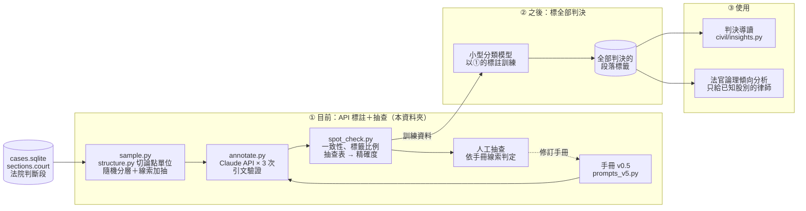

# annotation/：段落功能標註

依標註手冊標記判決**法院判斷段**各論點單位的功能（證據評價、涵攝、請求判斷、給付額酌定等），
以 LLM 標註、程式驗證引文、人工依線索抽查。結果供判決導讀使用，也是日後分析法官論理傾向的基礎。

負責：（待填）

## 現況

| | 狀態 |
|---|---|
| 標註手冊 | 🟢 v0.5（[論點標註手冊_v0.5.md](論點標註手冊_v0.5.md)） |
| 標註流程（抽樣 → 標註 → 抽查） | 🟢 程式完成，見下方 |
| v0.3、v0.4 標註與抽查（各 290 段 × 3 次） | 🟢 完成，結果見下方 |
| 論點單位切分（`structure.py`） | 🟢 完成，3,000 件判決測試 |
| v0.5 標註與抽查（論點單位、新抽判決） | 🟡 待執行 |
| 小型分類模型（取代 API，標全部判決） | ⬜ 規劃中 |
| 接上判決導讀（取代 `civil/insights.py` 的 rule-v0） | ⬜ 等 v0.4 抽查通過 |
| 法官論理傾向分析 | ⬜ 規劃中 |

🟢 完成　🟡 進行中　⬜ 尚未開始

## 架構



## 檔案

| 檔案 | 內容 |
|---|---|
| `論點標註手冊_v0.5.md` | 標籤定義、規則、驗證方式、已知限制（目前版本） |
| `prompts_v5.py` | 與手冊 v0.5 對應的 prompt（民事 13 類、刑事 10 類） |
| `論點標註手冊_v0.3.md`、`_v0.4.md`、`prompts_v3.py`、`prompts_v4.py` | 前幾版，保留供追溯先前的結果 |
| `structure.py` | 依編號層級（壹、一、㈠、⒈、⑴、①）把法院判斷段切成論點單位（最多 1,200 字） |
| `cues.py` | 手冊列出的線索詞，抽樣與抽查共用 |
| `sample.py` | 從法院判斷段抽論點單位；記錄單位在原文的位置（`unit_start`／`unit_end`）與判決結果 |
| `annotate.py` | 呼叫 Claude API 標註，可中斷續跑、有預算上限（預設 $4） |
| `spot_check.py` | 模型自身一致性、標籤比例、CONCL 和判決結果比對、抽查表的輸出與計分 |
| `../tools/evaluate_units.py` | 切法比較：組員的 400 字段落 vs 論點單位（N=800–2000） |
| `requirements.txt` | 本資料夾額外需要的套件（`anthropic`） |

## 執行

所有指令在 repo 根目錄執行。資料庫與輸出都在 `artifacts/`（不進 Git）。

```bash
pip install -r annotation/requirements.txt

# 1. 抽樣（預設讀 artifacts/retrieval_civil_v3/cases.sqlite）
python -m annotation.sample --n-random 200 --n-enriched 30

# 2. 標註：先 dry run、再試 1 段，確認沒問題再跑三次
python -m annotation.annotate --dry-run
python -m annotation.annotate --run-no 1 --limit 1
python -m annotation.annotate --run-no 1
python -m annotation.annotate --run-no 2
python -m annotation.annotate --run-no 3

# 3. 抽查：輸出抽查表 → 人工填「判定」欄 → 計分
python -m annotation.spot_check export
python -m annotation.spot_check score
```

輸出位置：

```
artifacts/annotation_civil_v3/          （v0.3 在 annotation_civil_v1/、v0.4 在 annotation_civil_v2/）
├── annotation.sqlite     paragraphs（抽出的論點單位）、annotations（模型標註，每個標籤一列；EV 的 basis 在 subtype）
├── meta.json             來源、種子、切段方式、各批數量、git commit
└── 抽查表_v0.5.xlsx       人工抽查用
```

## 驗證方式與目前的結果

v0.3 起沒有法律專業人員參與，驗證分四層（細節見手冊第七節）：

| 層次 | 做法 | 能證明 |
|---|---|---|
| 沿用 | CL、BOP、ADM 定義未改，沿用 v0.1、v0.2 與法律系學生比對的結果 | 這些標籤的效度 |
| 線索抽查 | RULE、SUB、CONCL、EV、PROC、DAM、EXP 各抽 25 個單位，人工判斷標籤與引文 | 精確度、引文正確率（不含召回率） |
| 引文自動檢查 | 引文是否含該標籤的動作用語（手冊規則 10） | 篩出可疑引文 |
| 判決結果比對 | CONCL 的方向和 `cases.outcome` 比對（敗訴卻有理由＝衝突） | 篩出可疑的 CONCL |
| 自身一致性 | 每段標三次 | 穩定度（不等於正確） |

v0.4 的結果（民事 290 段 × 3 次，人工抽查）：

| 標籤 | 精確度 | 引文正確 |
|---|---|---|
| RULE | 25/25 | 25/25 |
| PROC | 24/24 | 24/24 |
| DAM | 12/12 | 12/12 |
| EV | 19/24 = 0.79（95% CI 0.60–0.91） | 18/19 |
| SUB | 19/24 = 0.79 | 18/19 |

- 三次標註一致性約 89%
- v0.5 依抽查結果新增 CONCL（請求判斷從 SUB 分出），並釐清 EV／SUB／UNC 的界線（見手冊 v0.5 的變更紀錄）
- 模型漏標：一造辯論的段落只標 UNC 漏了 PROC（7 次）、民事沒有 HI 標籤、BOP 漏 1 次

v0.3 的結果（民事 290 段 × 3 次，人工抽查各 25 段）：

| 標籤 | 精確度 | 95% CI |
|---|---|---|
| DAM | 22/22 = 1.0000 | [0.8513, 1.0000] |
| EV | 21/24 = 0.8750 | [0.6900, 0.9566] |
| PROC | 19/22 = 0.8636 | [0.6666, 0.9525] |
| SUB | 17/21 = 0.8095 | [0.6000, 0.9233] |

- 模型三次完全相同 92.8–93.4%；隨機樣本 NONE 38.5%
- EV 判符合者中 33% 引文引到列舉證據 → v0.4 新增規則 10（引文錨定）
- 只有大前提的段落（5.5%）模型標法分散在 8 種標籤 → v0.4 新增 RULE

v0.2 以前的結果（法律系學生為參考標準）：

- 模型三次標註完全相同的比例：93–97%（兩輪）
- 句式固定的標籤（判例援引、舉證責任、不爭執事項、經驗法則）模型與法律系學生幾乎全部一致
- **證據評價（EV）一致性偏低**（kappa −0.15～0.28），相關結論須保守解讀
- 法律專業的驗證只來自一位法律系學生，共 77 段

## 限制

- 標註範圍是 `sections.court`（法院判斷段），原告主張與被告答辯不標
- v0.5 起標註單位是論點單位（`structure.py`），和判決導讀的段落（`civil.insights._paragraphs()`，400 字）不同；要接上導讀，需用引文在原文的位置（`unit_start` + 引文位移）對回導讀段落
- CONCL 和判決結果的比對是案件層級：一件判決有多個請求、反訴或抗辯時，「衝突」不一定是標錯
- 法官層級的結果只能給已知承辦股別的使用者（起訴後才分案）；民眾版只呈現法院與案件類型層級
- 判決段落已遮蔽當事人姓名，但第三人姓名仍可能殘留（見 `retrieval/masking.py`），標註結果不進 Git

資料夾的分法見 [docs/repo結構.md](../docs/repo結構.md)。
