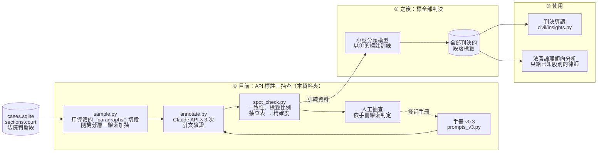

# annotation/：段落功能標註

依標註手冊標記判決**法院判斷段**各段落的功能（證據評價、涵攝、舉證責任、給付額酌定等），
以 LLM 標註、程式驗證引文、人工依線索抽查。結果供判決導讀使用，也是日後分析法官論理傾向的基礎。

負責：（待填）

## 現況

| | 狀態 |
|---|---|
| 標註手冊 | 🟢 v0.3（[論點標註手冊_v0.3.md](論點標註手冊_v0.3.md)） |
| 標註流程（抽樣 → 標註 → 抽查） | 🟢 程式完成，見下方 |
| v0.3 標註與抽查 | 🟡 待執行 |
| 小型分類模型（取代 API，標全部判決） | ⬜ 規劃中 |
| 接上判決導讀（取代 `civil/insights.py` 的 rule-v0） | ⬜ 等 v0.3 抽查通過 |
| 法官論理傾向分析 | ⬜ 規劃中 |

🟢 完成　🟡 進行中　⬜ 尚未開始

## 架構



## 檔案

| 檔案 | 內容 |
|---|---|
| `論點標註手冊_v0.3.md` | 標籤定義、規則、驗證方式、已知限制 |
| `prompts_v3.py` | 與手冊 v0.3 對應的 prompt（民事 10 類、刑事 9 類） |
| `cues.py` | 手冊列出的線索詞，抽樣與抽查共用 |
| `sample.py` | 從法院判斷段抽段落；切段直接用 `civil.insights._paragraphs()`，段落序號與判決導讀一致 |
| `annotate.py` | 呼叫 Claude API 標註，可中斷續跑、有預算上限 |
| `spot_check.py` | 模型自身一致性、標籤比例、抽查表的輸出與計分 |
| `requirements.txt` | 本資料夾額外需要的套件（`anthropic`） |

## 執行

所有指令在 repo 根目錄執行。資料庫與輸出都在 `artifacts/`（不進 Git）。

```bash
pip install -r annotation/requirements.txt

# 1. 抽樣（預設讀 artifacts/retrieval_civil_v4/cases.sqlite）
python -m annotation.sample --n-random 200 --n-enriched 30

# 2. 標註：先 dry run、再試 1 段，確認沒問題再跑三次
python -m annotation.annotate --dry-run
python -m annotation.annotate --run-no 1 --limit 1
python -m annotation.annotate --run-no 1
python -m annotation.annotate --run-no 2
python -m annotation.annotate --run-no 3

# 3. 抽查：輸出抽查表 → 人工填「判定」欄 → 計分
python -m annotation.spot_check export
python -m annotation.spot_check score
```

輸出位置：

```
artifacts/annotation_civil_v1/
├── annotation.sqlite     paragraphs（抽出的段落）、annotations（模型標註，每個標籤一列）
├── meta.json             來源、種子、切段方式、各批數量、git commit
└── 抽查表_v0.3.xlsx       人工抽查用
```

## 驗證方式與目前的結果

v0.3 起沒有法律專業人員參與，驗證分三層（細節見手冊第七節）：

| 層次 | 做法 | 能證明 |
|---|---|---|
| 沿用 | CL、HI、BOP、EXP、UNC、ADM 定義未改，沿用 v0.1、v0.2 與法律系學生比對的結果 | 這些標籤的效度 |
| 線索抽查 | DAM、SUB、EV、PROC 各抽 25 段，人工判斷模型標的是否符合手冊 | 精確度（不含召回率） |
| 自身一致性 | 每段標三次 | 穩定度（不等於正確） |

v0.2 以前的結果（法律系學生為參考標準）：

- 模型三次標註完全相同的比例：93–97%（兩輪）
- 句式固定的標籤（判例援引、舉證責任、不爭執事項、經驗法則）模型與法律系學生幾乎全部一致
- **證據評價（EV）一致性偏低**（kappa −0.15～0.28），相關結論須保守解讀
- 法律專業的驗證只來自一位法律系學生，共 77 段

## 限制

- 標註單位是 `sections.court`（法院判斷段），原告主張與被告答辯不標；切段方式若在 `civil/insights.py` 改變，需重新抽樣標註
- 法官層級的結果只能給已知承辦股別的使用者（起訴後才分案）；民眾版只呈現法院與案件類型層級
- 判決段落已遮蔽當事人姓名，但第三人姓名仍可能殘留（見 `retrieval/masking.py`），標註結果不進 Git

資料夾的分法見 [docs/repo結構.md](../docs/repo結構.md)。
