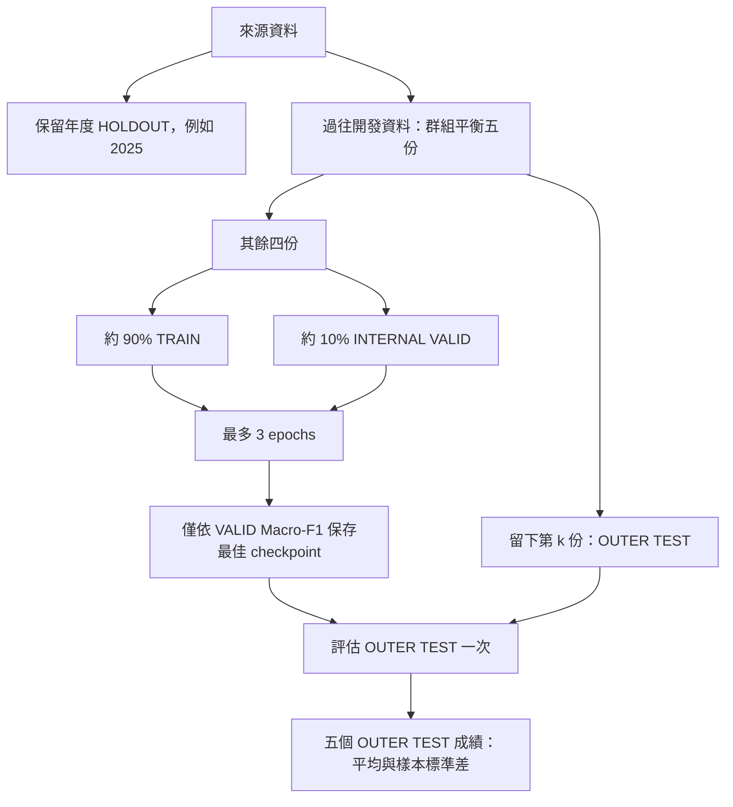

> 最新資料／類別政策：全國 2016–2025 候選 ≥150，固定 80 類罪名／102 類法條，不再逐折篩類別。共用分配與指令見 [NATIONAL150_SHARED_DATA.md](NATIONAL150_SHARED_DATA.md)。以下舊資料數字以新版說明為準。

# 每折內部 VALID 與外層 TEST

主入口現在採用 `kfold_test`：固定已選超參數，訓練 5 個模型，每個模型最多 3 epochs。這不是內層 K-fold 搜尋，也不額外訓練多組候選參數。

## 資料角色

保留年度（例如 2025）不進入五折。其餘開發資料先依案件／文件／完全相同 fact 的傳遞群組分成五份，盡量平衡任務標籤、月份及筆數。

每輪留下其中一份作外層 TEST；其餘四份再依相同群組規則分成十個平衡桶，取一桶作內部 VALID，其餘作 TRAIN。這十桶只用於取得約 10% 的驗證樣本，**不訓練十個模型**。

以開發資料為分母，每輪約 72% TRAIN、8% VALID、20% TEST。群組不可拆分，因此比例是近似值。



## 選模與報告

- 每個 epoch 僅評內部 VALID；early stopping 與 checkpoint 選擇僅看 VALID Macro-F1。
- 訓練結束載入 best.pt，才評當輪外層 TEST。TEST 不用於挑 epoch、閾值或 fold。
- `main/cv_summary.json` 的 `test` 是正式五折結果，`primary_metric_source=outer_test`。`validation` 僅為選模診斷。
- 各模型仍是從預訓練權重重新開始，參數設定相同。
- 多標籤預測採共用 at_least_one 規則：sigmoid > 0.5，否則取最高分一類。

## 2025 保留集

每折的 `holdout.jsonl` 為保留年度資料；每折的 `test.jsonl` 則來自該輪開發資料中的外層 fold，兩者不可混稱。manifest 將 evaluation_role 標成 outer_test、test_year 設為 null，另外記錄 holdout_year。

主五折不會自動評保留年度。需要另外評 2025 時，全部五折完成後可執行：

```sh
python -m judgment_bert.test_evaluation --prepared runs/experiment/prepared_main --runs runs/experiment/main --output runs/experiment/test_2025
```

評估器會依新模式自動讀 holdout.jsonl。此結果另存，不混入外層五折 TEST 平均；要求各折類別清單及保留集完全相同，否則拒絕合併。

## 指令

在 model/ 執行，資料必須是本機檔案：

```sh
python train_model.py --data /path/source.jsonl --output runs/new_outer_test --folds 5 --epochs 3 --no-time-cv
```

first_year 與 test_year 由 experiment config 指定。使用目前全國資料時，設 first_year=2016、test_year=2025；範例 config 的歷史起點仍為 2018，使用者需依資料調整。

單獨準備資料而不訓練：

```sh
python -m judgment_bert.cross_validation prepare --data /path/source.jsonl --output data/new_outer_test --mode kfold_test --folds 5 --first-year 2016 --test-year 2025
```

底層 `prepare_cv()` 的舊預設 kfold 保留給既有 grid／歷史實驗；主入口與 prepare CLI 均明確選用 kfold_test。TimeCV 保持額外分析，預設關閉，完成主五折後才會依設定啟動。

## 類別門檻尚未變更

本次仍按每折最終 TRAIN 出現 >=30 次建立類別清單。未自動套用 >=150 或固定輸出清單；因此類別空間仍可能因 fold 不同而不同，正式比較 baseline 前需先決定共同清單。

建議後續方案是：在抽樣後的開發資料（不含 2025）中保留 >=150 次的類別，固定清單供所有 fold／模型使用，之後不再逐折過濾。不是在完整 113 萬筆計算後就認定抽樣也足夠；同時多標籤混合案件的保留／排除規則仍需一致。>=150 可提高每折支援數，不能保證群組切分後每折一定達到特定次數，也無法消除類別不平衡。改分類頭維度須重新訓練。

## 為何不直接用 fold // 2

在目前 10 萬筆樣本，來源 meta.fold // 2 的五組筆數為 20,027／20,037／19,737／19,951／20,248，但有 642 組完全相同的去首尾空白 fact 跨組。原始十組也有 697 組跨組。這是對目前樣本套用該欄位的檢查，不是對方實驗輸出的測量。

因此維持同案／文件／相同 fact 綁定的平衡分組；各模型應共用最後產生的 manifest，而不是各自直接使用來源雜湊 fold。不同輪次重複使用 TRAIN 是正常 K-fold；同一輪 TRAIN、VALID、TEST 間出現相同 fact 才是應避免的洩漏。

## 舊 run

先前沒有內部 VALID 的本機 run 已停止，權重與日誌保留，沒有把其分數混入新協定。新的長時間訓練尚未啟動。舊 run 的 96 類與資料分佈紀錄見 EVALUATION_ALIGNMENT.md，屬於舊協定的稽核資料。

## 目前 10 萬筆資料的準備檢查（尚未訓練）

| Fold | TRAIN | INTERNAL VALID | OUTER TEST | 2025 HOLDOUT | 類別數 |
|---|---:|---:|---:|---:|---:|
| fold_01 | 64,700 | 7,188 | 17,971 | 9,965 | 95 |
| fold_02 | 64,699 | 7,187 | 17,973 | 9,965 | 95 |
| fold_03 | 64,698 | 7,187 | 17,974 | 9,965 | 95 |
| fold_04 | 64,699 | 7,188 | 17,972 | 9,965 | 95 |
| fold_05 | 64,701 | 7,189 | 17,969 | 9,965 | 95 |

逐筆檢查：四個資料角色間同案、文件、完全相同 fact 重疊均為 0；類別過濾前每筆開發資料恰作外層 TEST 一次，合計 90,001 筆。各 fold 均為相同 95 類及相同 2025 保留集。內部 VALID 切出後 TRAIN 較小，未經許可入國罪亦未達 30 次，因此由舊協定 96 類變為 95 類。沒有套用 >=150，也沒有提交個案資料。
